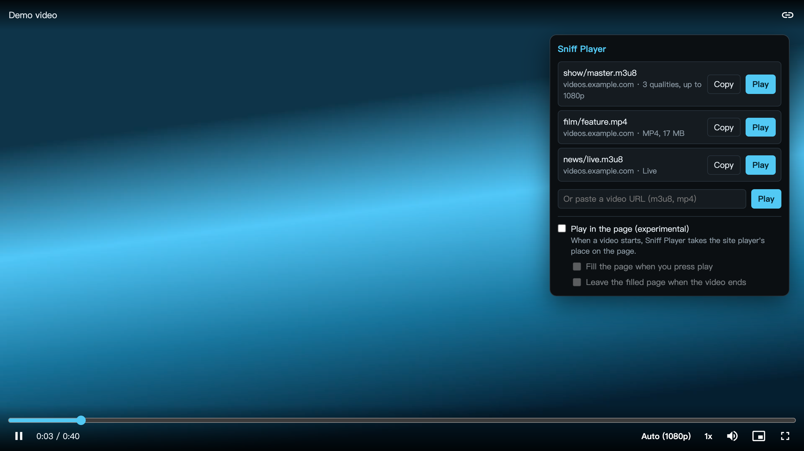
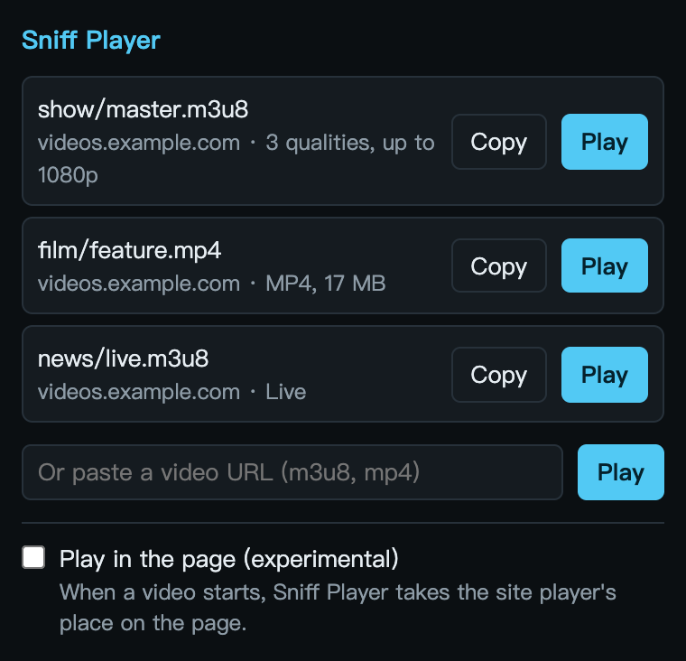

  

<h1 align="center">Sniff Player</h1>

  <b>Find the videos a page loads, and play them in one click.</b> 
  A Chrome extension with its own player for HLS and MP4. Nothing else to install.

  English · <a href="README.zh-TW.md">繁體中文</a>

  

---

## What it is

A page's video player can be slow, cramped or full of overlays. Sniff Player watches what the page loads, lists the videos it finds, and opens the one you pick in a clean player of its own.

Use it to play content you have the right to watch. It doesn't download anything, and it doesn't get around DRM.

For every feature in detail, see [docs/FEATURES.md](docs/FEATURES.md).

## Features

- **Finds videos as they load.** The number on the icon counts the videos in the current tab.
- **HLS and video files.** HLS (m3u8), plus MP4, M4V, WebM, MOV and OGV files your browser can decode.
- **One row per video.** The qualities of one video are folded into a single row, with its length or a Live tag.
- **A player with quality and speed controls.** Keyboard shortcuts included, and a clear message when a video can't play.
- **Paste a URL.** Play any m3u8 or video file link directly.
- **Play in the page (experimental).** Off by default. When it's on, Sniff Player takes the place of the site's player, with a button to fill the page.
- **Buttons on videos.** With the pointer on a video: picture-in-picture, fill the page, and Sniff Player, which plays it right there. <kbd>F2</kbd> and <kbd>F3</kbd> work too.
- **English and Traditional Chinese.** It follows your browser's language.

## Install

Install it from the [Chrome Web Store](https://chromewebstore.google.com/detail/dlibpccmiokdbmkjneblkfhfmenhidkj).

A new version reaches the store after its review, so the latest release here can be ahead of it. To use that one, load it yourself:

1. Download the zip from the [latest release](https://github.com/xxxxDev/sniff-player/releases/latest) and unzip it, or clone this repository.
2. Open `chrome://extensions` and turn on **Developer mode**.
3. Choose **Load unpacked** and select the unzipped folder. In a clone, select the `extension` folder.

It needs Chrome 116 or later.

## Use it

1. Open a page and start the video. Many pages load nothing until you press play.
2. Click the Sniff Player icon. The list shows what it found.
3. Press **Play**, or **Copy** to take the URL.

  

In the player: <kbd>Space</kbd> or <kbd>K</kbd> plays and pauses, <kbd>←</kbd> <kbd>→</kbd> skip 5 seconds, <kbd>M</kbd> mutes, <kbd>F</kbd> goes full screen.

## Limits

- **DRM-protected video can't be played.** The player tells you when a video's key can't be fetched.
- **Short-lived links expire.** Some sites issue links that last only minutes. If one has expired, reload the page and open the video again.
- **Some links only work on their own page.** A site can tie a link to your IP address, your device or a one-time token.
- **Video files under 5 MB are left out.** They are usually ads or intros.
- **Segments aren't listed.** An MP4 that a streaming site fetches piece by piece from script can't be played alone. DASH (mpd) isn't supported yet.
- **Not available in Incognito windows.** This keeps private browsing apart from your normal sign-ins.
- **Play in the page is experimental.** A site that rebuilds its player can take the place back, and a page of several videos is matched by the one you start.

## Privacy and permissions

Sniff Player has no server and no analytics, and it sends nothing to its authors. The list of detected URLs stays in the browser's session storage and is gone when you close the browser. A video you play is a normal tab, so its URL can stay in your browser history. It needs access to all sites because it has to see what any page loads. A small script in every page shows the buttons on videos and reads nothing else. With Play in the page on, or when you press Sniff Player on a video, it also puts a script into that page to swap the player there; that player's requests are the page's own. The full [privacy policy](PRIVACY.md) is in this repository and at [v-ax.com](https://v-ax.com/privacy/sniff-player/). [SECURITY.md](SECURITY.md) explains each permission and what the extension sends to the sites you visit.

## Third-party

The player is built on [hls.js](https://github.com/video-dev/hls.js) 1.7.3, under the Apache License 2.0. Its licenses are in [extension/vendor](extension/vendor).

## Contributing

See [CONTRIBUTING.md](CONTRIBUTING.md) for how to report a bug or send a change.

## License

The code is under the [MIT License](LICENSE). The icon isn't: see [BRAND.md](BRAND.md).

Sniff Player is an independent project. It is not made by, affiliated with or endorsed by Google. Chrome is a trademark of Google LLC.

Made by [V-AX](https://v-ax.com).
