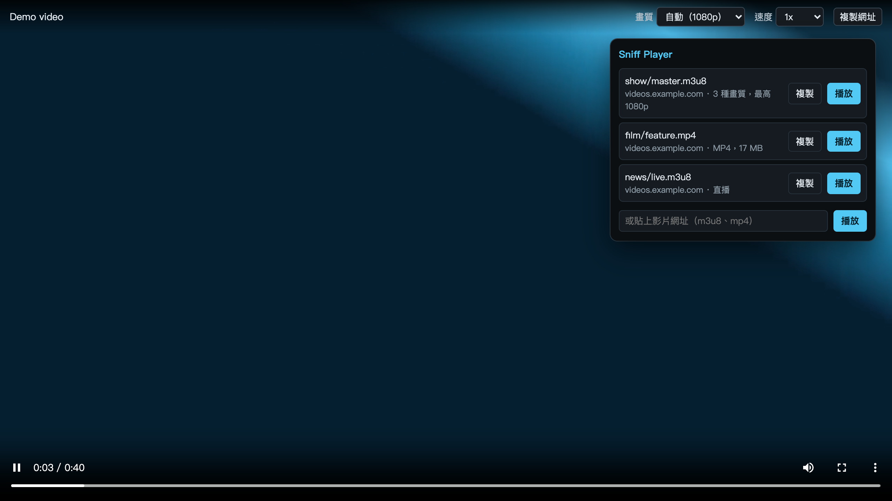
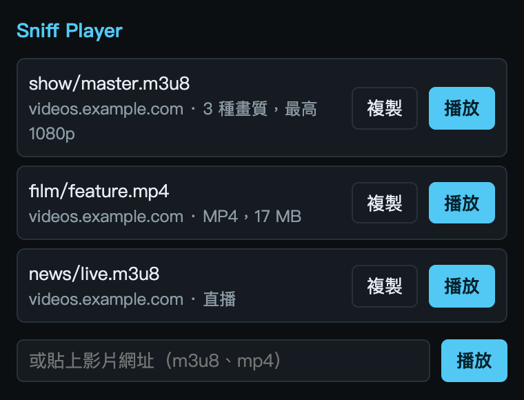

  

<h1 align="center">Sniff Player</h1>

  <b>找出網頁載入的影片，點一下就能播放。</b> 
  內建 HLS 與 MP4 播放器的 Chrome 擴充工具，不必另外安裝任何東西。

  <a href="README.md">English</a> · 繁體中文

  

---

## 這是什麼

網頁內建的播放器可能很慢、畫面很小，或蓋滿各種浮層。Sniff Player 會觀察網頁載入了什麼，列出找到的影片，再用自己乾淨的播放器開啟你選的那支。

請用來播放你有權觀看的內容。它不會下載任何東西，也不會繞過 DRM。

完整功能說明請看 [docs/FEATURES.zh-TW.md](docs/FEATURES.zh-TW.md)。

## 功能

- **影片一載入就找到。** 圖示上的數字是目前分頁的影片數量。
- **支援 HLS 和影片檔。** HLS (m3u8)，以及瀏覽器能解碼的 MP4、M4V、WebM、MOV、OGV 檔案。
- **一支影片一筆。** 同一支影片的不同畫質會合併成一筆，並標示片長或直播。
- **可切換畫質和速度的播放器。** 有快捷鍵，影片無法播放時也會明確說明原因。
- **貼上網址。** 可直接播放任何 m3u8 或影片檔連結。
- **英文和繁體中文。** 依瀏覽器語言顯示。

## 安裝

Sniff Player 沒有上架 Chrome 線上商店，需要自己載入：

1. 從[最新版本](https://github.com/xxxxDev/sniff-player/releases/latest)下載 zip 並解壓縮，或 clone 這個 repo。
2. 開啟 `chrome://extensions`，打開**開發人員模式**。
3. 按**載入未封裝項目**，選解壓縮後的資料夾。如果是 clone，請選 `extension` 資料夾。

需要 Chrome 116 以上。

## 使用

1. 打開網頁並開始播放影片。很多網頁要按下播放才會開始載入。
2. 點 Sniff Player 圖示，清單會列出找到的影片。
3. 按**播放**，或按**複製**取得網址。

  

在播放器裡：<kbd>空白鍵</kbd>或 <kbd>K</kbd> 播放暫停，<kbd>←</kbd> <kbd>→</kbd> 前後跳 5 秒，<kbd>M</kbd> 靜音，<kbd>F</kbd> 全螢幕。

## 限制

- **DRM 保護的影片無法播放。** 取不到影片金鑰時，播放器會告訴你。
- **短效連結會過期。** 有些網站的連結只有幾分鐘效期。過期時請重新整理頁面，再開一次影片。
- **有些連結只在原頁面有效。** 網站可能把連結綁定 IP、裝置或一次性權杖。
- **小於 5 MB 的影片檔不列出。** 這類檔案多半是廣告或片頭。
- **不列出分段。** 串流網站用程式分段抓取的 MP4 無法單獨播放。尚未支援 DASH (mpd)。
- **無痕視窗無法使用。** 避免無痕瀏覽和平常的登入身分混在一起。

## 隱私與權限

Sniff Player 沒有伺服器，也沒有使用分析，不會傳任何資料給作者。偵測到的網址清單只存在瀏覽器的工作階段儲存空間，關閉瀏覽器就會消失。你播放的影片是一般分頁，所以網址可能留在瀏覽紀錄裡。它需要存取所有網站，因為要看得到任何網頁載入了什麼。每項權限的用途，以及它會送什麼給你造訪的網站，請看 [SECURITY.md](SECURITY.md)。

## 第三方元件

播放器使用 [hls.js](https://github.com/video-dev/hls.js) 1.7.3，採 Apache License 2.0。授權文字在 [extension/vendor](extension/vendor)。

## 授權

程式碼採 [MIT 授權](LICENSE)。圖示不在此授權內，請看 [BRAND.md](BRAND.md)。
