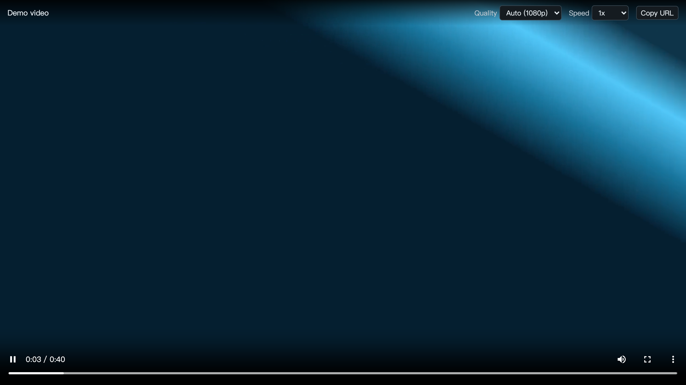
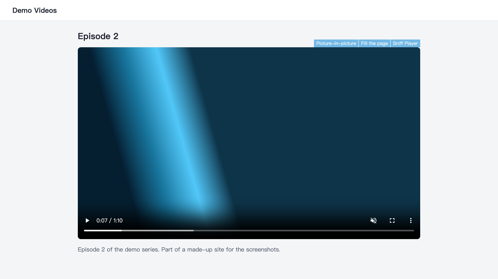
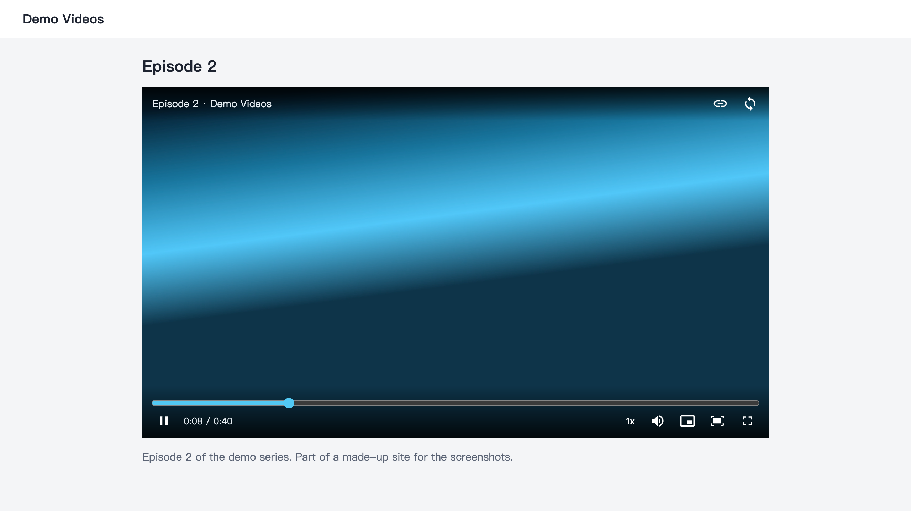
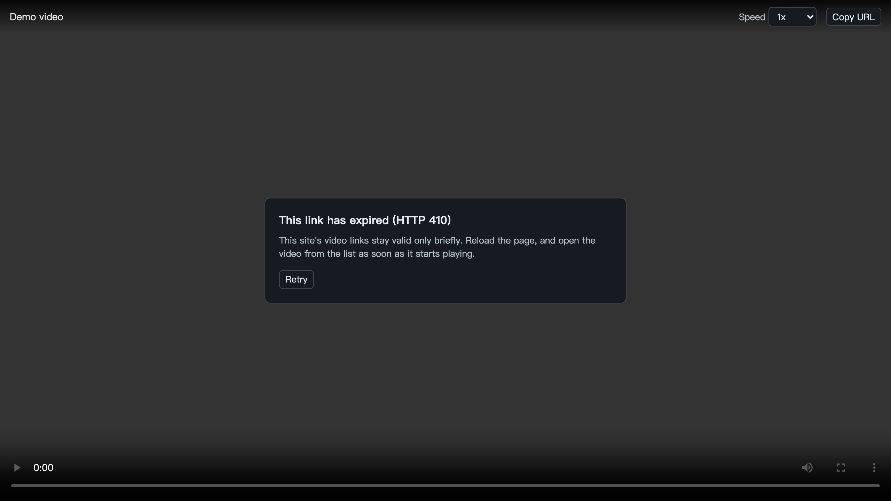

# Features

English · [繁體中文](FEATURES.zh-TW.md)

## Detection

Sniff Player watches the network responses of your tabs. It doesn't scan the page, so it sees a video only once the page actually requests it. The number on the icon and an open list both update as that happens.

A response counts as **HLS** when the server says so in its content type, or when its URL has `.m3u8` and the type is vague (`text/plain`, `application/octet-stream` or none). HTML, JSON, images and failed responses never count.

A response counts as a **video file** when a `<video>` element on the page loaded it, it's MP4, M4V, WebM, MOV or OGV, and it's at least 5 MB. A file of unknown size is kept. Whether it plays depends on the codecs your browser can decode. Files a site fetches from script are left out, because those are segments of a stream.

When a page's service worker makes the request, Sniff Player matches it back to the tab by origin.

## The list

- **One row per video.** Sniff Player reads each playlist it finds once, to learn which playlists are qualities of the same video and how long it runs. Rows with quality choices come first, then the newest.
- **What a row shows.** The host, plus the number of qualities and the highest one, the length, a Live tag, or the file's format and size.
- **Play or Copy.** Copy gives you the exact URL.
- **Paste a URL.** The box under the list plays any m3u8 or video file link.
- **When the list empties.** A real navigation clears it. A route change in a single-page site doesn't, so a long session there can collect older rows.

Sometimes rows don't fold together: a site can answer each read of a playlist with newly signed URLs. The extra rows can still be played. A tab keeps up to 100 rows, and a playlist larger than 2 MB isn't read.

## The player

- **Quality.** Auto, or any quality in the stream, when it has more than one. Auto shows which one is playing.
- **Speed.** 0.5x to 2x.
- **Copy URL.** The URL of the video that's open.
- **Controls.** Play and pause, a seek bar with the time, quality, speed, copy URL, picture-in-picture, volume and full screen, all on the bar.
- **Keyboard.** <kbd>Space</kbd> or <kbd>K</kbd> plays and pauses, <kbd>←</kbd> <kbd>→</kbd> skip 5 seconds, <kbd>↑</kbd> <kbd>↓</kbd> change the volume, <kbd>M</kbd> mutes, <kbd>F</kbd> goes full screen.
- **Controls that get out of the way.** They hide while the video plays and the mouse is still.

  

## Buttons on videos

Move the pointer onto a video and three buttons show above its top right corner. They work with the setting below off.

- **Picture-in-picture.** Or press <kbd>F3</kbd>.
- **Fill the page.** The video, with the site's own player and its controls, fills the browser window and the rest of the page steps aside. Press <kbd>F2</kbd> to do the same, and <kbd>F2</kbd> or <kbd>Esc</kbd> to go back.
- **Sniff Player.** Plays that video right there in Sniff Player, as Play in the page does, from the same point. Start the video first: Sniff Player plays what the page has loaded.

In the popup, under **Buttons on videos**, untick the ones you don't want; with all three off, none show. <kbd>F2</kbd> and <kbd>F3</kbd> work either way.

  

## Play in the page (experimental)

Off by default. Turn it on with the checkbox at the bottom of the list. When a video starts on a page, Sniff Player pauses the site's player and takes its place, at the same size, from the same point of the video.

- **Sound as the site had it.** Sniff Player starts at full volume, muted if the site's player was muted, and its sound button or volume bar turns the sound on.
- **The right video on a page of several.** A video file is matched by its URL. A stream is matched to the video you just started: of those playing, the largest.
- **The next one takes over.** Start another video on the page, the next episode say, and Sniff Player moves there. The last one goes back to the site's player, paused at the point you reached, and playing it again brings Sniff Player back to it.
- **Short clips stay with the site.** A clip under a minute, a site's intro or an ad say, plays on in the site's player, with anything the site asks first, such as an age check. Sniff Player takes over when the episode starts.
- **Fill the page.** The button between volume and full screen makes the player fill the browser window, with the rest of the page out of the way. Press it again, or <kbd>Esc</kbd> or <kbd>W</kbd>, to go back.
- **Fill the page on its own.** Two options under the setting, both off by default: fill the page when you press play on the site's player, and leave it when the video ends. A video that starts by itself, without your press, doesn't fill the page.
- **Back to the site's player.** A button on the bar, at the point you reached. Sniff Player then leaves that frame alone until it goes to another page.
- **When it does nothing.** The script that swaps the player runs in a page only once a video is found there. Some sites rebuild their player, and Sniff Player then gives the place back to the site.

  

## When a video can't play

The player says why, in place of a black screen, and offers a retry.

  

| You see | What it means |
|---|---|
| The site refused this video (401 or 403) | The link may have expired, or the site only allows viewing on its own page |
| This link has expired (410) | The site's links are short-lived. Reload the page and open the video as soon as it starts |
| Video not found (404) | The link has expired or the video is gone |
| Couldn't get the video's key | The video may be protected by DRM, which this player can't play |

## Sites that check where a request comes from

The player first asks for a video without saying which page it came from. If a host refuses with 401 or 403, the player sends that host and its subdomains the origin of the page where the video was found, and tries again from the same position. It does this once per host, in that player tab only. It doesn't send it to everyone from the start, because some video hosts refuse requests that name another site.

For video files the browser doesn't report the status, so the first failure of any kind retries this way, for the host in the video's URL.

## Cookies

The player sends your cookies only to the video's own host and its subdomains, so videos you are signed in to keep working. A playlist can't send your cookies to another host. The automatic read of a playlist sends no cookies at all, so a playlist that needs a sign-in may show no qualities or length in the list, but can still be played.
