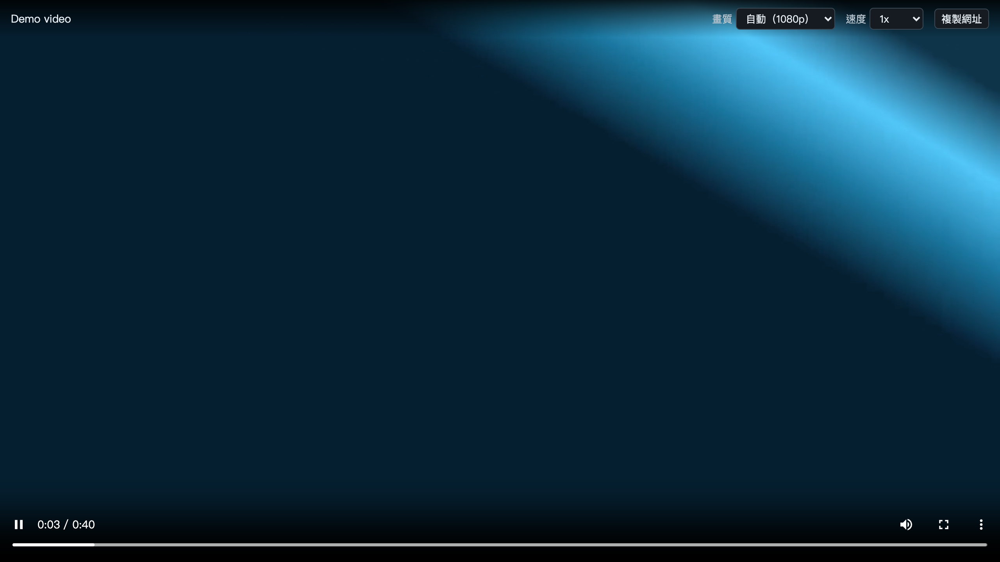
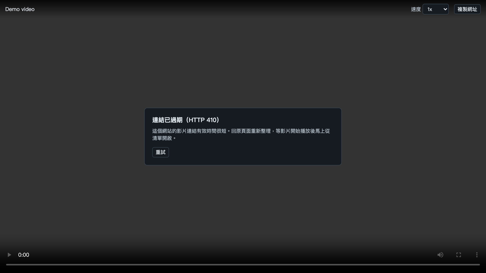

# 功能說明

[English](FEATURES.md) · 繁體中文

## 偵測

Sniff Player 監看分頁的網路回應，不掃描網頁內容，所以網頁實際請求影片時才看得到。圖示上的數字和開著的清單都會同時更新。

**HLS** 的判斷：伺服器的回傳類型標明是 HLS，或網址帶 `.m3u8` 而類型不明（`text/plain`、`application/octet-stream` 或沒有）。HTML、JSON、圖片和失敗的回應都不算。

**影片檔** 的判斷：由網頁的 `<video>` 元素載入、格式是 MP4、M4V、WebM、MOV 或 OGV，而且至少 5 MB。大小不明的會保留。能不能播放，要看瀏覽器能否解碼。網站用程式抓取的檔案不列出，因為那是串流的分段。

如果請求是網頁的 Service Worker 發出的，Sniff Player 會依來源比對回分頁。

## 清單

- **一支影片一筆。** Sniff Player 會把找到的每份播放清單讀一次，判斷哪些是同一支影片的不同畫質，以及片長多少。可選畫質的排最前面，其餘新的在前。
- **每筆顯示的資訊。** 主機名稱，加上畫質數量與最高畫質、片長、直播標記，或影片檔的格式與大小。
- **播放或複製。** 複製會取得完整的原始網址。
- **貼上網址。** 清單下方的輸入框可播放任何 m3u8 或影片檔連結。
- **清單何時清空。** 真正換頁時會清空。單頁式網站換路由不會，所以停留久了清單可能累積舊項目。

有時幾筆無法合併：網站可能每次回應播放清單時都給新的簽章網址。多出來的項目一樣能播。每個分頁最多保留 100 筆，超過 2 MB 的播放清單不會讀取。

## 播放器

- **畫質。** 自動，或串流裡的任一畫質。自動模式會顯示目前的畫質。
- **速度。** 0.5x 到 2x。
- **複製網址。** 目前開啟的影片網址。
- **鍵盤。** <kbd>空白鍵</kbd>或 <kbd>K</kbd> 播放暫停，<kbd>←</kbd> <kbd>→</kbd> 前後跳 5 秒，<kbd>M</kbd> 靜音，<kbd>F</kbd> 全螢幕。
- **不擋畫面的工具列。** 影片播放且滑鼠不動時會自動隱藏。

  

## 影片無法播放時

播放器會說明原因，不會只留下黑畫面，也可以重試。

  

| 你看到的訊息 | 代表什麼 |
|---|---|
| 網站拒絕播放這支影片（401 或 403） | 連結可能已過期，或網站限定要從原頁面觀看 |
| 連結已過期（410） | 這個網站的連結效期很短。重新整理頁面，影片一開始播放就馬上開啟 |
| 找不到影片（404） | 連結已過期或影片已被移除 |
| 無法取得影片金鑰 | 影片可能受 DRM 保護，這個播放器無法播放 |

## 會檢查請求來源的網站

播放器一開始請求影片時，不說明來自哪個網頁。如果某個主機以 401 或 403 拒絕，播放器才會把發現影片的網頁來源送給那個主機和它的子網域，再從原本的位置重試。每個主機只試一次，也只限那個播放分頁。不一開始就全部送出，是因為有些影片主機反而會拒絕帶著別站來源的請求。

影片檔的情況瀏覽器不會回報狀態，所以第一次失敗不論原因，都會對影片網址的主機這樣重試一次。

## Cookie

播放器只把你的 Cookie 送給影片所在的主機和它的子網域，所以你登入後才能看的影片仍可播放。播放清單無法把你的 Cookie 送到其他主機。自動讀取播放清單時完全不帶 Cookie，所以需要登入的清單可能不顯示畫質和片長，但一樣能播。
